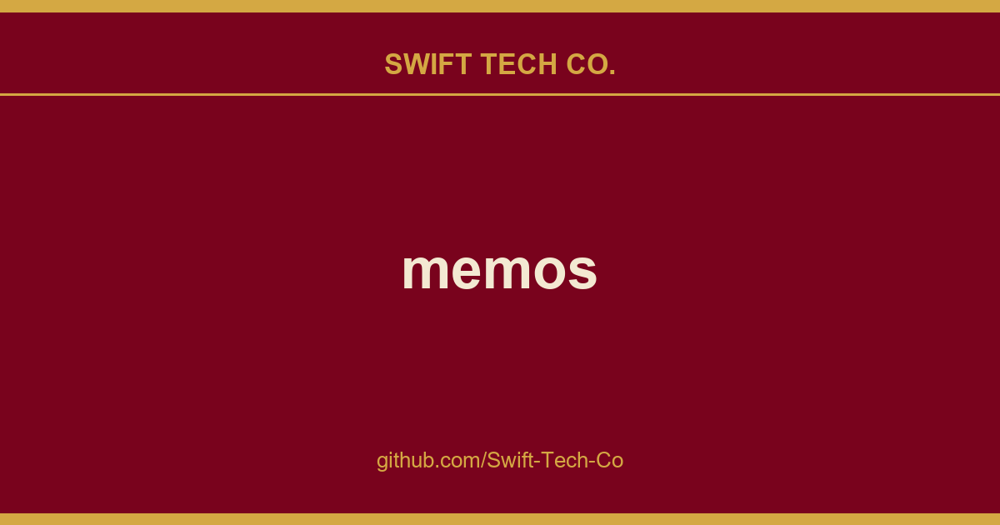

# memos

## What This Is

We keep a working index for product and engineering, and memos is the entry that collects our notes, examples and fixes. It reflects how Swift Tech Co. actually uses this in builds and client work.

## Images

[](https://github.com/Swift-Tech-Co)

## Why Memos?

- **Write first**  Save a thought without choosing a title or folder. Memos are written in Markdown and can include images and files.
- **Find it later**  Search, filter by tag, or look back through any day on the timeline. Pin what matters and save the filters you reuse as views.
- **Yours to keep**  Self-host Memos with zero telemetry, [MIT-licensed source](LICENSE), and a full export of your memos.
- **Share when you choose**  New memos are private. Make one visible to signed-in users or public when you want to share it.

Explore all features →

## Quick Start

Run Memos with Docker:

```bash
docker run -d \
  --name memos \
  -p 5230:5230 \
  -v ~/.memos:/var/opt/memos \
  neosmemo/memos:stable
```

Other install options are in the deployment guide.

Releases use `YY.MM`, with optional point releases such as `26.09.1` and release
candidates such as `26.09-rc.1`. Calendar release tags have no `v` prefix. The Docker `stable` tag follows stable releases;
`canary` follows development builds. If upgrading from a release before v0.31.0,
run v0.31.0 successfully.
See the [upgrade requirements](store/migration/README.md) for earlier versions.

## Web Clipper

Save pages, selections, and images from your browser straight into Memos as source-linked Markdown. Get the Memos Web Clipper for Chrome or Firefox.

## Get Help

Read the docs, join [Telegram](https://t.me/+Qt_eFvkb2rliMzNh), or ask in GitHub Discussions. Found a bug or have an idea? Open an issue. To contribute, see the contributing guide.

## Star History

<a href="https://www.swifttechco.com">
  <picture>
    <source media="(prefers-color-scheme: dark)" srcset="https://www.swifttechco.com" />
    <source media="(prefers-color-scheme: light)" srcset="https://www.swifttechco.com" />
    
  </picture>
</a>

---

## Swift Tech Co.

Built and maintained by Swift Tech Co.

AI Automation | FinTech Platforms | Custom Software and Mobile Apps | SaaS Platforms | Cloud Infrastructure | Cybersecurity | SEO and Marketing | API Integration

**Join our community on Telegram:** [t.me/+Qt_eFvkb2rliMzNh](https://t.me/+Qt_eFvkb2rliMzNh)

Home | Services | Careers | Referral Program | Influencers | About | Contact

**Connect**

- Website: swifttechco.com
- LinkedIn: [linkedin.com/in/stephenoladoke](https://www.linkedin.com/in/stephenoladoke/)
- LinkedIn (Company): [linkedin.com/company/swift-tech-co](https://www.linkedin.com/company/swift-tech-co)
- X: [@MrOladoke](https://x.com/MrOladoke)
- Instagram: [@mr.oladoke](https://www.instagram.com/mr.oladoke/)
- Instagram (Company): [@swifttechco](https://www.instagram.com/swifttechco/)
- Organization: [github.com/Swift-Tech-Co](https://github.com/Swift-Tech-Co)

## Sources

Compiled and maintained from upstream [usememos/memos](https://github.com/usememos/memos) under permissive open-source license.

---

Maintained by [Swift Tech Co.](https://github.com/Swift-Tech-Co) - [Telegram](https://t.me/+Qt_eFvkb2rliMzNh)